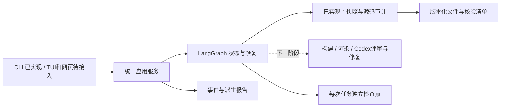

# Room Agent 新架构：第一阶段

当前仅提供 **保存源码的快照、语法审计和持久化恢复**。运行结果中的 `completed` 表示这个审计任务结束，不能解释为房间重建或质量通过。原有 `scripts/run_room_004.sh` 继续承担完整重建任务。

计划见 [implementation-plan.md](docs/implementation-plan.md)，实际完成范围和自检证据见 [status.md](docs/status.md)。

## 分层与状态



| 数据 | 权责 |
| --- | --- |
| `input.json` + `input.sha256.json` | 不可变请求；保存源文件清单、hash、房间和流程版本 |
| `checkpoints.sqlite` | 图的执行位置与节点输出；每个 run 单独保存 |
| `events/*.json` | 递增事件，记录节点、错误、暂停前后的调用；原子写入 |
| `rooms/<room>/revisions/<run>/` | 源码和依赖文件副本；续跑前校验，绝不直接编辑 |
| `result.json` | 便于导出的状态摘要；恢复时不信任它 |

`show` 从检查点和最近执行事件重建状态，并通过运行锁判断进程是否还在运行。它展示上次执行结果，不持续扫描大文件；`run` / `resume` 会实际核验产物。事件中出现多次 `node_started` 可能是节点重放，不能据此认定重复生成了模型。

## 安装和运行

要求 Python 3.11+、Linux 或 macOS、本地 POSIX 文件系统。使用独立环境；不要直接改动已有 Blender/TRELLIS 环境。

在仓库根目录：

```bash
python3.11 -m venv scripts/room-agent/.venv
scripts/room-agent/.venv/bin/python -m pip install --require-hashes -r scripts/room-agent/requirements.lock
scripts/room-agent/.venv/bin/python -m pip install --no-deps -e scripts/room-agent
```

创建审计任务（将 SOURCE 改为含 `Room.py` 的已有保存源码目录）：

```bash
scripts/room-agent/.venv/bin/room-agent \
  --state-root /yinxin/projects/room/return_output/agent_state \
  create --room room_004 --source /完整路径/round_03/room
```

命令返回 `run_id`。将下面的 RUN_ID 换成该值：

```bash
scripts/room-agent/.venv/bin/room-agent --state-root /yinxin/projects/room/return_output/agent_state run RUN_ID
scripts/room-agent/.venv/bin/room-agent --state-root /yinxin/projects/room/return_output/agent_state show RUN_ID
scripts/room-agent/.venv/bin/room-agent --state-root /yinxin/projects/room/return_output/agent_state events RUN_ID --after 0
scripts/room-agent/.venv/bin/room-agent --state-root /yinxin/projects/room/return_output/agent_state resume RUN_ID --action finish
```

`run` 执行到人工确认节点便结束当前进程，状态是 `waiting_for_input`。`resume --action finish` 确认完成源码审计；`--action cancel` 结束任务并保留证据。技术故障或进程中断后使用 `resume RUN_ID`，不带 action，从未完成节点恢复。输入本身有错则更正输入并创建新任务，不篡改已保存版本。

查询全部任务用 `list`。输出为 JSON；失败输出 JSON 错误到终端 stderr 并返回退出码 1，节点错误同时持久化。参数/版本校验在启动前失败时不会伪造一次图执行记录。

源目录限制 1 GiB、10000 个文件，拒绝软链接和特殊文件；当前只支持源码目录，不能直接输入扫描 tar 或 `.blend`。这些是基础审计的容量边界，不是未来重建流程的限制。

## 自检

```bash
scripts/room-agent/.venv/bin/python -m pytest -q scripts/room-agent/tests
```

测试使用真实 LangGraph、SQLite、独立子进程和文件锁。模拟在原子发布之后、节点检查点之前强退，验证恢复复用；故障恢复不只靠正常的 finish/resume 测试。

LangGraph 在节点级重放，不会自动恢复 Blender/TRELLIS 正运行的内部状态。参见官方 [持久化文档](https://docs.langchain.com/oss/python/langgraph/persistence) 和 [中断文档](https://docs.langchain.com/oss/python/langgraph/interrupts)。

## 目前限制

- 没有接入真实构建、渲染、视觉评审、修复和 ingest/reconstruct，也没有网页或后台调度器。
- SQLite 和文件锁仅在本机实测；学校持久化目录如果是 NFS 等共享盘，必须先验证锁与数据库语义，再决定使用本地工作盘加持久数据库或 PostgreSQL。不要把“目录持久化”当成数据库并发安全的证明。
- 一个房间当前只允许一个写操作；不同房间状态隔离，但尚无 GPU 任务队列。
- 快照不可变是程序契约，不是操作系统访问控制；管理员仍可改动文件，下一次执行会检出。复制目前不去重，磁盘用量随任务增加。
- 查询只读检查点但首次查询会创建 SQLite 元数据；事件文件用于诊断，不是面向海量事件的索引服务。
- 输入版本不匹配明确拒绝恢复；尚未实现跨版本迁移器。第一阶段未完成的开发任务可重新创建，不能将这一行为套用于昂贵的 GPU 任务。

代码在 `scripts/room-agent`；运行输出放 `return_output`，不进入 Git。服务器启动验证属于下一阶段关卡。
